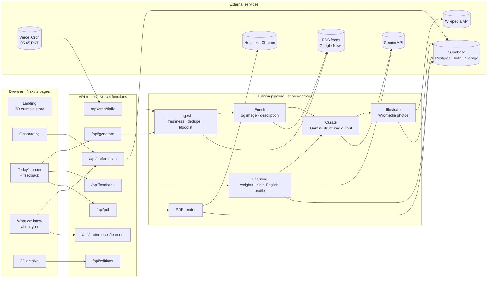

# Architecture

The Morning Paper is a single Next.js app on Vercel. The browser talks only to our own API routes. All outside calls (Gemini, RSS, Wikipedia, Supabase, headless Chrome) live in `src/server/integrations`. Each edition is generated once, stored as validated JSON, and rendered twice: as a web page and as a PDF.

## System diagram



## Printing an edition

```mermaid
sequenceDiagram
  participant R as Reader / Vercel Cron
  participant G as /api/generate
  participant I as Ingest + Enrich
  participant L as Learning
  participant C as Curate (Gemini)
  participant W as Illustrate (Wikipedia)
  participant DB as Supabase

  R->>G: Print (session) or daily cron (CRON_SECRET)
  G->>DB: Load preferences, mark edition "generating"
  par in parallel
    G->>I: Fetch feeds and Google News per topic and keyword
    G->>L: Refresh learned profile from 14 days of feedback
    G->>DB: Load URLs printed in the last 3 days
  end
  I-->>G: Fresh, de-duplicated articles with photos where available
  G->>C: Shortlist of up to 60 articles + reader profile
  C-->>G: Story picks by article id, headlines, summaries, layout, image subjects
  G->>G: Validate with Zod, drop unknown ids, join real URLs and sources
  G->>W: Photos for stories without one
  G->>DB: Save edition (status "ready")
  G-->>R: The edition (web page renders; PDF on download, cached in Storage)
```

## Data model

| Table | Purpose |
| --- | --- |
| `preferences` | One row per reader: name, topics with weights, keywords, blocked keywords, sources, reading time, timezone, `learned_profile` (plain-English themes with evidence) |
| `editions` | One per reader per day: status, the edition JSON (`payload`), cached `pdf_path` |
| `feedback` | Every signal: like, dislike, skip, less_like_this, click, read (with seconds) |
| Storage `papers/` | Cached PDFs at `papers/<user>/<date>.pdf` |

Row Level Security limits every reader to their own rows. The service-role key is used only on the server, for writing editions and PDFs and for the daily cron. Even then, every query filters by `user_id` explicitly.

## Key decisions

- **One edition, two renderings.** The web page and the PDF both read the same stored JSON, so they always match.
- **The model never produces links or media.** Gemini returns article ids and a subject name for each photo; URLs, sources, dates and images come from feeds, article pages or Wikipedia.
- **Validated at every boundary.** Zod schemas guard forms, requests, responses, stored editions and the model's output.
- **Feedback is explainable.** Numeric weights stay internal; readers see and correct what was learned, in plain English, with the stories that taught it.
- **Cheap on AI quota.** One Gemini call per edition, plus a short profile refresh; no retry when the quota is exhausted.
- **Serverless-friendly.** Feeds and enrichment run in parallel with hard time budgets; headless Chrome is bundled for Vercel; the daily cron prints three readers at a time within the function limit.
